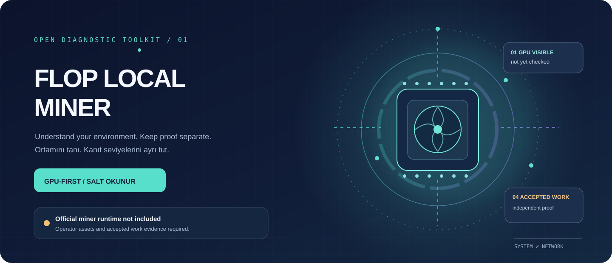
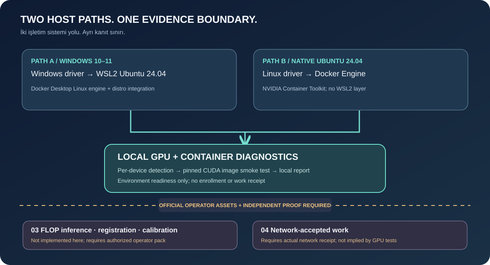
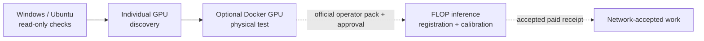
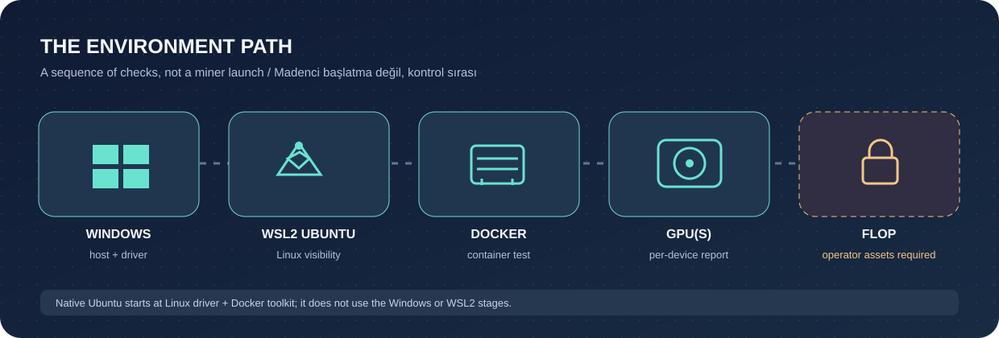
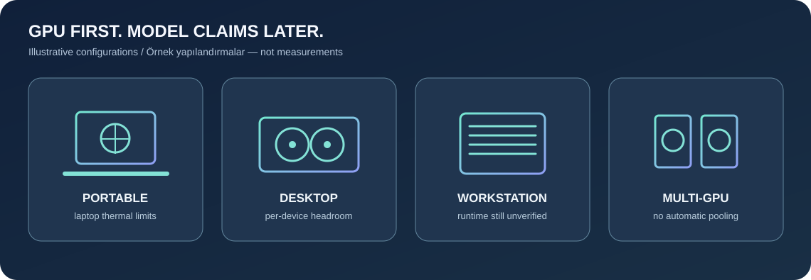

<div align="center">



# FLOP LOCAL MINER

**GPU-first diagnostics / Önce GPU, sonra ortam ve ağ kanıtı**

[**🇹🇷 Türkçe kurulum**](docs/README.tr.md) · [**🇬🇧 English setup**](docs/README.en.md) · [**Animated bilingual guide / Animasyonlu rehber ↗**](https://omerbek.github.io/flop-local-miner/site/)


[](https://github.com/omerbek/flop-local-miner/actions/workflows/ci.yml)

</div>

> **UPDATED / GÜNCELLENDİ — 6 November 2026:** The **repository tools** are still read-only diagnostics, **not** a packaged miner installer. However, a community-operated RTX 5090 Laptop GPU **did successfully run the official FLOP backend/worker**, register via sponsor, and receive **130 GFLOP/s accepted SOFT calibration** on Devnet. **No paid work/rewards were verified.** / Repo araçları hâlâ teşhis amaçlıdır; fakat resmî FLOP miner ile gerçek RTX 5090 Laptop kurulumu ve zincirde kabul edilmiş kalibrasyon doğrulandı. Ücretli iş veya kazanç doğrulanmadı. **[🇹🇷 Gerçek kurulum](docs/VERIFIED-DEVNET-SETUP.tr.md) · [🇬🇧 Verified setup](docs/VERIFIED-DEVNET-SETUP.en.md)**



## Follow the evidence / Kanıt seviyelerini izleyin



**Stages 1 and 2 never imply 3 or 4.** Repo's original diagnostic development machine reported an RTX 3060 Laptop with unavailable WSL/Docker; this was **a different machine**. Subsequently, user-provided real RTX 5090 Laptop logs and finalized Devnet state verified level 3 externally: [field report](examples/rtx-5090-laptop.md). The diagnostic scripts have still **not themselves deployed a miner**.



## ✅ Real-world verified miner / Sahada doğrulanan miner

**6 Nov 2026:** A Windows/WSL2 RTX 5090 Laptop GPU was registered with sponsored stake, ran the official FLOP worker/backend and obtained accepted **130 GFLOP/s SOFT calibration (64 verified jobs / 623 blocks)**. These are owner-provided CLI/on-chain outputs, **not CI test results**. Paid jobs/rewards were not shown. The repository's own tools remain diagnostic-only.

**[🇹🇷 Baştan sona kurulum](docs/VERIFIED-DEVNET-SETUP.tr.md) · [🇬🇧 End-to-end field guide](docs/VERIFIED-DEVNET-SETUP.en.md) · [🧰 Practical troubleshooting](docs/FIELD-TROUBLESHOOTING.md)**

On an **already configured official FLOP runtime**, you can read status without changing any secrets:

```bash
bash scripts/miner-health.sh YOUR_MINER_SS58_ADDRESS
```

## Quick start / Hızlı başlangıç

1. **Read-only Windows checks / Windows salt okunur kontrol:** open PowerShell at repository root, review the scripts, then run:

   ```powershell
   powershell -NoProfile -File .\scripts\diagnose.ps1
   powershell -NoProfile -File .\scripts\prepare.ps1
   py -3 scripts\gpu_detect.py --json
   ```

   **Expected / Beklenen:** GPU count plus per-device facts or actionable `needs intervention`. **If blocked / Hata:** no driver → [NVIDIA downloads](https://www.nvidia.com/Download/index.aspx); WSL virtualization disabled → [Microsoft WSL guide](https://learn.microsoft.com/en-us/windows/wsl/install). Nothing is auto-installed.

   `--dry-run` on `gpu_detect.py` intentionally skips GPU **and** network probes: use it only to preview report structure, never as a hardware reading. / `--dry-run` GPU ve ağ ölçümünü atlar; gerçek teşhis için yukarıdaki komutu kullanın. Human reports: `python3 scripts/gpu_detect.py --lang tr` or `--lang en`.

2. **Read-only WSL2 Ubuntu or native Ubuntu checks / Ubuntu kontrolleri:** choose the separate [Windows→WSL path](docs/README.en.md#1--windows-1011--wsl2-ubuntu-2404) / [Türkçe](docs/README.tr.md#1--windows-1011--wsl2-ubuntu-2404) or [native Ubuntu path](docs/README.en.md#2--native-ubuntu-2404-not-wsl) / [Türkçe](docs/README.tr.md#2--yerel-ubuntu-2404-wsl-olmayan).

   ```sh
   bash scripts/preflight.sh
   python3 scripts/gpu_detect.py --json
   ```

   **Expected / Beklenen:** per-GPU visibility and separate environment checks. **If blocked / Hata:** unavailable `nvidia-smi` or Docker daemon → use [troubleshooting](docs/TROUBLESHOOTING.md), not an unreviewed installer.

3. **Optional GPU container / İsteğe bağlı GPU konteyner:** only after reviewing the [pinned diagnostic image](docs/RESEARCH.md) and explicitly consenting to a pull/run:

   ```sh
   bash scripts/gpu-container-test.sh --dry-run
   bash scripts/gpu-container-test.sh --run
   ```

   **Expected / Beklenen:** container `nvidia-smi` shows GPU(s) = *container access only*. **If blocked / Hata:** check Docker Desktop WSL integration or native Container Toolkit, not FLOP wallet/account settings.

   This machine's 528.49 driver reports CUDA API max 12.0; the pinned CUDA 12.6.3 container is **not verified compatible here**, and WSL/Docker are unavailable. / Bu makinede 528.49 sürücü CUDA 12.0 bildiriyor; CUDA 12.6.3 imaj uyumu ve WSL/Docker testi doğrulanmadı.

4. **Optional official public catalog / İsteğe bağlı resmî açık katalog:**

   ```sh
   python3 scripts/network_check.py --dry-run
   python3 scripts/gpu_detect.py --online-models --json
   ```

   **Expected / Beklenen:** catalog entries may receive only preliminary `possible but unverified`/`insufficient memory`/`unknown`; never infer FLOP support from a slug or estimated VRAM. **If blocked / Hata:** offline/timeout → `unknown`, no invented model or hash. [Compatibility details / Uyumluluk](docs/GPU-COMPATIBILITY.md).

## What exists / Neler var

| Scope / Kapsam | State / Durum |
| --- | --- |
| Read-only Windows and Ubuntu checks, multi-GPU inventory, masked JSON / Salt okunur teşhis | Implemented; physical results depend on host / Uygulandı; sonuç hosta bağlı |
| Optional digest-pinned NVIDIA CUDA container probe / İsteğe bağlı sabitlenmiş CUDA testi | Needs explicit `--run` and compatible Docker/driver / Açık onay ve uygun ortam şart |
| Official FLOP worker/backend, model measurement and chain registration / Resmî FLOP entegrasyonu | **Field verified with external official runtime; not implemented by this repo.** See [TR](docs/VERIFIED-DEVNET-SETUP.tr.md) / [EN](docs/VERIFIED-DEVNET-SETUP.en.md). |
| Paid or accepted FLOP work / Ücretli veya kabul edilmiş iş | **Not demonstrated / Kanıtlanmadı**; 64 verified **calibration** jobs are not paid receipts. |



The [live animated dashboard](https://omerbek.github.io/flop-local-miner/site/) (also available as [offline local HTML](site/index.html)) uses original SVG art, an English/Türkçe switch, keyboard-accessible steps and optional **local-only** JSON report import. It does not upload a report or start a miner. Motion respects reduced-motion preferences. GitHub README SVGs are static fallback; use the live page or open the offline HTML for motion.

## Documentation / Belgeler

[🇹🇷 Verified field install](docs/VERIFIED-DEVNET-SETUP.tr.md) · [🇬🇧 Verified setup](docs/VERIFIED-DEVNET-SETUP.en.md) · [EN diagnostics](docs/README.en.md) · [TR teşhis](docs/README.tr.md) · [GPU compatibility](docs/GPU-COMPATIBILITY.md) · [Official integration boundary](docs/OFFICIAL-INTEGRATION.md) · [Troubleshooting](docs/TROUBLESHOOTING.md) · [Field fixes](docs/FIELD-TROUBLESHOOTING.md) · [Miner checklist](docs/MINER-CHECKLIST.md) · [RTX 5090 laptop example](examples/rtx-5090-laptop.md) · [Evidence and official sources](docs/RESEARCH.md) · [Security](SECURITY.md) · [Contributing](CONTRIBUTING.md) · [MIT License](LICENSE)

Physical GPU/container tests require a correctly configured machine; Python fixtures in CI are **not** hardware verification. No code/assets from third-party [UfukNode/flop-miner-setup](https://github.com/UfukNode/flop-miner-setup) or NVIDIA GPU Operator are included; [source comparison](docs/RESEARCH.md) documents independent design principles.
