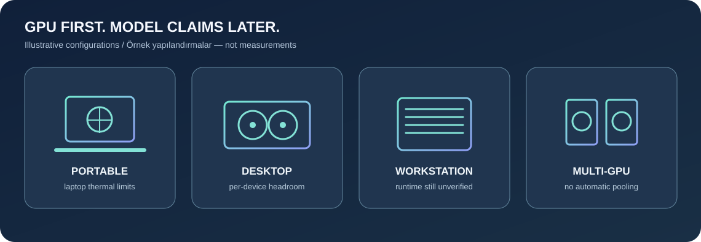
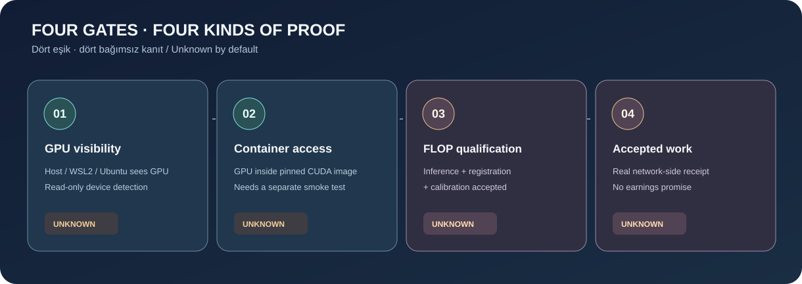

# FLOP Local Miner — English guide

[Türkçe rehber](README.tr.md) · [Home](../README.md) · [Animated interactive guide ↗](https://omerbek.github.io/flop-local-miner/site/) · [Compatibility](GPU-COMPATIBILITY.md) · [Official integration boundary](OFFICIAL-INTEGRATION.md)



> **Not a functioning FLOP miner.** This open-source project diagnoses GPUs and prepares the host. It cannot start a miner without the official operator pack, identity/approval, checkpoint, policy, registration and calibration. Devnet earnings are not promised. The observed machine had an RTX 3060 Laptop GPU; the RTX 5090 example is not a real hardware test. [Sources and limitations](RESEARCH.md).

## 0 · Review the code

Download the repository and inspect scripts and [security notes](../SECURITY.md) before running anything. Commands are run from repository root. No admin privileges or wallet keys are requested. Each physical computer later needs its own miner identity, secret files, state and endpoint; GPUs are not combined automatically.

## 1 · Windows 10/11 → WSL2 Ubuntu 24.04

Windows 10 needs 21H2+ (or Windows 11), a supported NVIDIA **Windows** driver and a recent WSL kernel. Never install a Linux NVIDIA display driver inside WSL. A listed Ubuntu distro cannot start WSL2 when virtualization is disabled. [Microsoft CUDA/WSL](https://learn.microsoft.com/en-us/windows/ai/directml/gpu-cuda-in-wsl) · [NVIDIA WSL](https://docs.nvidia.com/cuda/wsl-user-guide/index.html).

**1. Windows diagnosis (read-only).** In PowerShell:

```powershell
nvidia-smi
wsl --status
wsl --list --verbose
powershell -NoProfile -File .\scripts\diagnose.ps1
powershell -NoProfile -File .\scripts\prepare.ps1
py -3 scripts\gpu_detect.py --json
```

**Example success:** `nvidia-smi` can show several GPUs; Ubuntu shows `VERSION 2` in `wsl --list --verbose`; GPU JSON contains `gpu_count` and per-device `status`. **Example failure:** `nvidia-smi: command not found` → install the official [NVIDIA driver](https://www.nvidia.com/Download/index.aspx); WSL2 virtualization failure → follow [Microsoft WSL instructions](https://learn.microsoft.com/en-us/windows/wsl/install) and inspect firmware virtualization settings. `prepare.ps1` only provides links and never modifies the system.

**2. Install WSL2/Ubuntu if needed.** This optional system change is solely your decision:

```powershell
wsl --install -d Ubuntu-24.04
wsl --list --verbose
```

**Example success:** `Ubuntu-24.04 ... 2`; **failure:** virtualization disabled → resolve Virtual Machine Platform/BIOS prerequisites via the official [WSL guide](https://learn.microsoft.com/en-us/windows/wsl/install); nothing is auto-fixed. Never blindly remove/replace an existing Ubuntu install.

**3. Docker Desktop and WSL integration.** Install [Docker Desktop](https://docs.docker.com/desktop/setup/install/windows-install/) yourself, choose Linux containers / **Use WSL 2 based engine**, then enable your Ubuntu under **Settings → Resources → WSL Integration**. `docker --version` on Windows alone does not prove WSL integration. [Official details](https://docs.docker.com/desktop/features/wsl/).

```powershell
docker --version
docker info
docker compose version
wsl -d Ubuntu-24.04
```

From Ubuntu, navigate to the repository (Windows drives appear under `/mnt/c/...` in WSL):

```sh
nvidia-smi || /usr/lib/wsl/lib/nvidia-smi
bash scripts/preflight.sh
python3 scripts/gpu_detect.py --json
docker info
docker compose version
```

**Example success:** `docker info` shows a server/daemon section; `nvidia-smi` lists GPUs. **Failure:** Docker daemon unavailable → check Desktop Linux engine, WSL integration and service status. WSL `nvidia-smi` may omit telemetry fields; that alone is not a GPU failure. Do not install a separate Linux display driver inside WSL.

**4. Optional physical container test:** inspect the script and [digest source](RESEARCH.md), then opt in to pulling/running an ephemeral GPU container only when ready:

```sh
bash scripts/gpu-container-test.sh --dry-run
bash scripts/gpu-container-test.sh --run
```

**Example success:** container `nvidia-smi` prints GPU rows; this is **level 2 evidence only**. **Failure:** `could not select device driver ... gpu` → inspect Desktop WSL2 backend, integration and [GPU support](https://docs.docker.com/desktop/features/gpu.md). Image is pinned to a CUDA 12.6.3 digest; driver/runtime compatibility is independent.

## 2 · Native Ubuntu 24.04 (not WSL)

This route requires a **Linux NVIDIA driver** and the [NVIDIA Container Toolkit](https://docs.nvidia.com/datacenter/cloud-native/container-toolkit/latest/install-guide.html) for a native Docker Engine; it is not an instruction to install a Linux driver in WSL. Perform installations only via official guides with explicit user consent.

```sh
nvidia-smi
bash scripts/preflight.sh
python3 scripts/gpu_detect.py --json
docker info
docker compose version
bash scripts/gpu-container-test.sh --dry-run
bash scripts/gpu-container-test.sh --run
```

**Example success:** devices appear separately and the container lists GPUs. **Failure:** absent `nvidia-smi` → investigate the Linux driver; Docker GPU failure → consult [Container Toolkit configuration](https://docs.nvidia.com/datacenter/cloud-native/container-toolkit/latest/install-guide.html). Other distros are not automatically supported.

## 3 · Network, models and evidence boundaries

```sh
python3 scripts/network_check.py --dry-run
python3 scripts/network_check.py --json
python3 scripts/gpu_detect.py --online-models --json
python3 -m unittest discover -s tests -v
```

The first network command shows destinations without connecting. The second only checks accessibility of documented public FLOP HTTPS sources; connectivity is not registration or operator approval. Model catalog access is opt-in: timeouts/offline yield `unknown`; `possible but unverified` is only a rough VRAM prefilter; `insufficient memory` needs a firm lower bound. `supported` requires actual registered model, exact checkpoint/revision, allowlisted policy, KV cache/context/concurrency/vLLM/TOPLOC and measured device evidence. Do not assume quantization. Details: [GPU compatibility](GPU-COMPATIBILITY.md).

For a readable English report use `python3 scripts/gpu_detect.py --lang en` and `python3 scripts/network_check.py --lang en --dry-run`; JSON keys remain stable when language changes. `gpu_detect.py --dry-run` **does not probe hardware**: it previews report structure, not evidence that a GPU is present or absent.

| Evidence | Can this project prove it? |
| --- | --- |
| 1. Host/WSL GPU visibility | Yes, on the host where run |
| 2. GPU access from Docker | Only with an explicit successful physical `--run` test |
| 3. FLOP inference + registration + accepted calibration | No; operator assets and real network evidence required |
| 4. Actual network-accepted work | No; public paid-session gates not open |



**5090 Windows laptop example:** [examples/rtx-5090-laptop.md](../examples/rtx-5090-laptop.md). This is not a measured RTX 5090 run. See [TR/EN troubleshooting](TROUBLESHOOTING.md) and [checklist](MINER-CHECKLIST.md) if blocked.
