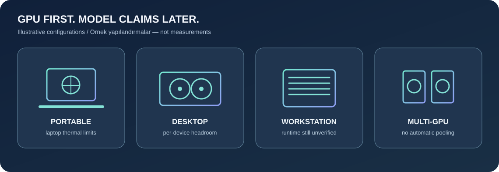
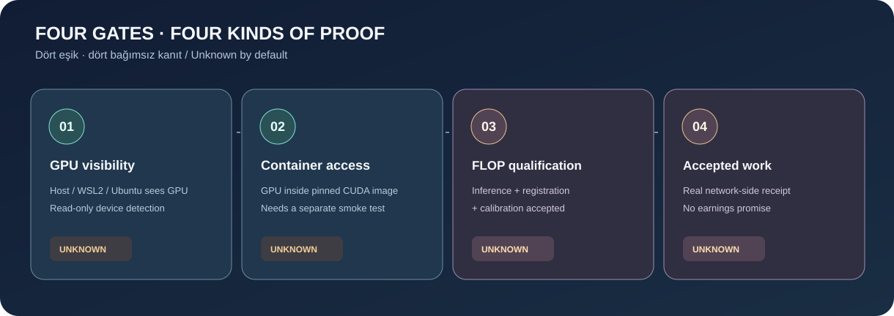

# FLOP Local Miner — Türkçe rehber

[English guide](README.en.md) · [Ana sayfa](../README.md) · [Animasyonlu etkileşimli rehber ↗](https://omerbek.github.io/flop-local-miner/site/) · [Uyumluluk](GPU-COMPATIBILITY.md) · [Resmî entegrasyon sınırı](OFFICIAL-INTEGRATION.md)



> **Bu dosya repo'nun tanılama araçlarını açıklar; bir FLOP miner kurucusu değildir.** Ancak 6 Kasım 2026'da gerçek bir RTX 5090 Laptop kurulumunda **resmî worker/backend, sponsorluk ve 130 GFLOP/s kabul edilmiş kalibrasyon** kullanıcı tarafından sağlanan zincir çıktılarıyla doğrulandı. **[Uçtan uca gerçek kurulum rehberi →](VERIFIED-DEVNET-SETUP.tr.md)**. Bu başarı tüm GPU'ları veya ücretli kazancı garanti etmez.

## 0 · Kodu inceleyin

Depoyu indirin; komutları çalıştırmadan önce betikleri ve [güvenlik notlarını](../SECURITY.md) inceleyin. Komutlar depo kökünden verilir. Yönetici yetkisi veya cüzdan anahtarı gerekmez. Her fiziksel bilgisayar ileride ayrı miner kimliği, gizli dosyalar, state ve endpoint gerektirir; GPU'ları otomatik birleştirmeyiz.

## 1 · Windows 10/11 → WSL2 Ubuntu 24.04

Windows 10 için 21H2+ ya da Windows 11, destekli NVIDIA **Windows** sürücüsü ve güncel WSL çekirdeği gerekir. WSL içine Linux NVIDIA ekran sürücüsü kurmayın. Ubuntu dağıtımı görünüyorsa bile sanallaştırma kapalıysa WSL2 başlatılamaz. [Microsoft CUDA/WSL](https://learn.microsoft.com/en-us/windows/ai/directml/gpu-cuda-in-wsl) · [NVIDIA WSL](https://docs.nvidia.com/cuda/wsl-user-guide/index.html).

**1. Windows teşhisi (salt okunur).** PowerShell'de:

```powershell
nvidia-smi
wsl --status
wsl --list --verbose
powershell -NoProfile -File .\scripts\diagnose.ps1
powershell -NoProfile -File .\scripts\prepare.ps1
py -3 scripts\gpu_detect.py --json
```

**Örnek başarı:** `nvidia-smi` birden çok GPU'yu gösterebilir; `wsl --list --verbose` içinde Ubuntu `VERSION 2`; GPU JSON'da `gpu_count` ve her kartın `status` alanı bulunur. **Örnek hata:** `nvidia-smi: command not found` → resmî [NVIDIA sürücüsünü](https://www.nvidia.com/Download/index.aspx) kurun; WSL2 sanallaştırma hatası → [Microsoft WSL yönergelerini](https://learn.microsoft.com/en-us/windows/wsl/install) ve firmware sanallaştırma ayarlarını inceleyin. `prepare.ps1` yalnızca bağlantı verir; sistem değiştirmez.

**2. Gerekiyorsa WSL2/Ubuntu kurun.** İsteğe bağlı sistem değişikliği yalnızca kullanıcı kararıyla:

```powershell
wsl --install -d Ubuntu-24.04
wsl --list --verbose
```

**Örnek başarı:** `Ubuntu-24.04 ... 2`; **hata:** sanallaştırma kapalı → Virtual Machine Platform/BIOS önkoşulunu resmî [WSL rehberinden](https://learn.microsoft.com/en-us/windows/wsl/install) çözün; otomatik düzeltilmez. Mevcut Ubuntu'yu körlemesine silmeyin/değiştirmeyin.

**3. Docker Desktop + WSL entegrasyonu.** [Docker Desktop'ı](https://docs.docker.com/desktop/setup/install/windows-install/) kendiniz kurun, Linux containers / **Use WSL 2 based engine** seçin, **Settings → Resources → WSL Integration** altında kullandığınız Ubuntu'yu etkinleştirin. Sırf Windows'ta `docker --version` görünmesi entegrasyon kanıtı değildir. [Resmî ayrıntılar](https://docs.docker.com/desktop/features/wsl/).

```powershell
docker --version
docker info
docker compose version
wsl -d Ubuntu-24.04
```

Ubuntu içinde depo klasörüne gidip (WSL'de Windows sürücüleri `/mnt/c/...` olarak görünür):

```sh
nvidia-smi || /usr/lib/wsl/lib/nvidia-smi
bash scripts/preflight.sh
python3 scripts/gpu_detect.py --json
docker info
docker compose version
```

**Örnek başarı:** `docker info` sunucu/daemon bölümünü içerir, `nvidia-smi` GPU listeler. **Hata:** Docker daemon bağlantısı yok → Desktop Linux engine/WSL integration ve servis durumunu inceleyin; WSL `nvidia-smi` bazı telemetri alanlarını göstermeyebilir, bu tek başına başarısızlık değildir. WSL içinden ayrıca Linux ekran sürücüsü kurmayın.

**4. İsteğe bağlı gerçek konteyner testi:** [digest kaynağını](RESEARCH.md) ve betiği inceleyin; indirme/ephemeral GPU konteynerini yalnızca hazır olduğunuzda başlatın:

```sh
bash scripts/gpu-container-test.sh --dry-run
bash scripts/gpu-container-test.sh --run
```

**Örnek başarı:** konteyner `nvidia-smi` GPU satırları döndürür; bu **yalnızca seviye 2** kanıtıdır. **Hata:** `could not select device driver ... gpu` → Desktop WSL2 backend, entegrasyon ve [GPU desteğini](https://docs.docker.com/desktop/features/gpu.md) kontrol edin. İmaj CUDA 12.6.3 digest'ine sabittir; sürücü/runtime uyumu ayrıdır.

## 2 · Yerel Ubuntu 24.04 (WSL olmayan)

Bu akışta **Linux NVIDIA sürücüsü** ve Docker Engine için [NVIDIA Container Toolkit](https://docs.nvidia.com/datacenter/cloud-native/container-toolkit/latest/install-guide.html) gerekir; WSL'e Linux sürücüsü kurma talimatı değildir. Kurulumları yalnızca resmî rehberler ve açık kullanıcı onayıyla yapın.

```sh
nvidia-smi
bash scripts/preflight.sh
python3 scripts/gpu_detect.py --json
docker info
docker compose version
bash scripts/gpu-container-test.sh --dry-run
bash scripts/gpu-container-test.sh --run
```

**Örnek başarı:** fiziksel GPU'lar tek tek görülür; konteyner komutu GPU listeler. **Hata:** `nvidia-smi` yok → Linux sürücüsünü; Docker GPU geçmiyorsa [Container Toolkit yapılandırmasını](https://docs.nvidia.com/datacenter/cloud-native/container-toolkit/latest/install-guide.html) inceleyin. Başka dağıtımlar otomatik destekli kabul edilmez.

## 3 · Ağ, model ve kanıt sınırları

```sh
python3 scripts/network_check.py --dry-run
python3 scripts/network_check.py --json
python3 scripts/gpu_detect.py --online-models --json
python3 -m unittest discover -s tests -v
```

İlk ağ komutu adresleri gösterir, bağlanmaz. İkinci komut yalnızca belgelenmiş genel FLOP HTTPS kaynaklarının erişimini ölçer; ağ erişimi kayıt/operatör izni değildir. Model kataloğu isteğe bağlıdır: zaman aşımı ve çevrimdışı durumda `unknown`; `possible but unverified` yalnızca kaba VRAM ön filtresi, `insufficient memory` yalnızca kesin alt sınır; `supported` için gerçek kayıtlı model, tam checkpoint/revision, policy allowlist, KV-cache/context/concurrency/vLLM/TOPLOC ve ölçülmüş donanım kanıtı gerekir. Quantization varsaymayın. Ayrıntı: [GPU uyumluluğu](GPU-COMPATIBILITY.md).

Okunabilir Türkçe rapor için `python3 scripts/gpu_detect.py --lang tr` ve `python3 scripts/network_check.py --lang tr --dry-run` kullanın; JSON alan adları dil değiştirince sabit kalır. `gpu_detect.py --dry-run` **donanım sorgulamaz**; yalnızca rapor biçimini gösterir, cihazın yokluğunun veya varlığının kanıtı değildir.

| Kanıt | Bu araçla elde edilebilir mi? |
| --- | --- |
| 1. Host/WSL GPU görünürlüğü | Evet, yalnızca çalıştırılan hostta |
| 2. Docker GPU erişimi | Yalnızca açık `--run` ve başarılı fiziksel konteyner testiyle |
| 3. FLOP inference + kayıt + kabul edilmiş kalibrasyon | Bu repo scriptleriyle değil; **resmî runtime kullanan gerçek bir RTX 5090 hostunda doğrulandı**. [Kanıt](VERIFIED-DEVNET-SETUP.tr.md) |
| 4. Ağın kabul ettiği gerçek iş | Hayır; public paid-session kapıları açık değil |



**5090 Windows laptop örneği:** [examples/rtx-5090-laptop.md](../examples/rtx-5090-laptop.md). Gerçek RTX 5090 saha kaydı için [doğrulanmış rehbere](VERIFIED-DEVNET-SETUP.tr.md) bakın. Sorun varsa [TR/EN troubleshooting](TROUBLESHOOTING.md) ve [checklist](MINER-CHECKLIST.md) dosyalarına bakın.
