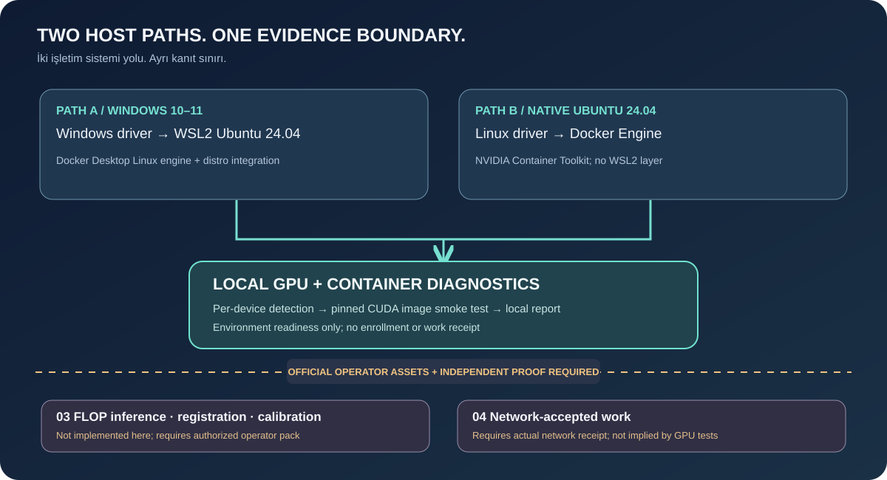

# 🇬🇧 FLOP GPU Miner — Verified Windows/WSL2 and Ubuntu field guide

[🇹🇷 Türkçe](VERIFIED-DEVNET-SETUP.tr.md) · [Home](../README.md) · [Troubleshooting](TROUBLESHOOTING.md)

> **Field evidence, 6 November 2026:** User-provided terminal logs and on-chain status confirm a **GeForce RTX 5090 Laptop GPU (24,463 MiB)** running an official FLOP worker/backend, BF16 verified model, sponsored registration and **130 GFLOP/s accepted SOFT calibration**. This does **not guarantee** that every NVIDIA GPU works or that paid mining is enabled. This repository continues to ship diagnostic tooling; it does not redistribute the official runtime.

## Evidence

| Item | Verified field result |
|---|---|
| GPU | 1× RTX 5090 Laptop GPU, 24,463 MiB |
| Miner account | `5H46MswbTSXsej7cQgBmmwHfNNrLDs2c8no4MezvK4NaDezd` (example, do not copy as your own) |
| Bond | 1,000,000 test FLOP delegated, active |
| Registered model | Qwen/Qwen2.5-0.5B-Instruct BF16 |
| Model root | `0x1a52c1abe781db051e70ae357f72bb70161ca0c092df0b618f22a9292ba63306` |
| Decode-policy hash | `0xeca6a3f9c5a9fa1556892182ffef15b1273c075146a2d1a87814ae83ecea3053` |
| Image versions | CLI 0.1.220, worker 0.1.238, backend 0.1.239 |
| Calibration | 130 GFLOP/s, 64 verified jobs, 623 blocks, SOFT; accepted block 3021110 |
| Declared GPU | [On-chain transaction](https://explorer.devnet.flop.network/transactions/0x970f88289f3beaac756f8ec416cf9f120bebaebbc143c66f24f497eaecf0b753) |
| Paid jobs | **Not demonstrated.** Devnet calibration ≠ paid receipt. |



## 1. Host preflight

Use Windows + WSL2 Ubuntu or native Ubuntu, NVIDIA drivers, Linux Docker + Compose, GPU passthrough and sufficient storage. WSL uses the **Windows GPU driver**; do not install a separate Linux NVIDIA display driver inside WSL. Laptop/desktop GPUs with similar names are not performance equivalents.

```bash
nvidia-smi --query-gpu=name,memory.total,driver_version --format=csv,noheader
docker info --format '{{.OSType}}'
docker compose version
```

**Never upload:** signer, mnemonic, miner.json keystore, secret-bearing miner.env, session-keys, worker state, or API tokens. Each physical host needs independent identities and keys. Check official image version/digests at [releases manifest](https://flop.network/releases.json).

## 2. Existing official runtime

The commands below assume a previously reviewed `/opt/flop-miner` runtime deployment. This diagnostic repository is **not a full installer**. Study the [official operator guide](https://docs.flop.network/docs/run-miner), verify versions and compare each command with the supported CLI for your release.

```bash
cd /opt/flop-miner
FLOP_CLI=$(sed -n 's/^FLOP_CLI=//p' miner.env)
test -n "$FLOP_CLI" || { echo 'FLOP_CLI missing'; exit 1; }
docker run --rm --network host "$FLOP_CLI" --network devnet --rpc wss://rpc.devnet.flop.network network status
```

## 3. Register a miner (not a validator)

Create and preserve a **separate sr25519 miner signer**. Do not overwrite an existing signer. A stake sponsor can register/bond a miner and add limited devnet funds; do not run another `miner register` after successful sponsorship. HTTP 429 codes such as `auto_miner_cap_full` and `daily_new_sponsorships` are server-side limits; respect `retryAfterSeconds` and don't rotate wallets to bypass them.

```bash
MINER_ADDRESS='YOUR_MINER_SS58_ADDRESS'
docker run --rm --network host "$FLOP_CLI" --network devnet --rpc wss://rpc.devnet.flop.network miner status "$MINER_ADDRESS" --json
```

Verify `registered:true` and `stake.active:true`. The worker signer must match this account.

## 4. Fetch the registered BF16 model

```bash
docker run --rm --network host -v /opt/flop-miner:/work "$FLOP_CLI" \
 --network devnet --rpc wss://rpc.devnet.flop.network \
 model fetch 0x1a52c1abe781db051e70ae357f72bb70161ca0c092df0b618f22a9292ba63306 \
 --precision BF16 --output-dir /work/models/qwen2.5-0.5b-instruct --json
```

Require `verified_root` or `computed_root` to match the registered root. In this field example, the first attempts returned `MODEL_VERIFICATION_FAILED` / `terminated`, while a later BF16 fetch produced **10 verified files and a 943 MB safetensors file**. The older CLI has `model get`, not `model show`. A `precision:FP16` field and `measured_root:null` from a generic metadata read do not disprove a successfully verified BF16 fetch. Avoid concurrent downloads; never bypass verification.

## 5. Start and health-check GPU backend

```bash
docker compose --env-file miner.env -f docker-compose.yml up -d backend
docker compose --env-file miner.env -f docker-compose.yml logs --tail=100 backend
docker compose --env-file miner.env -f docker-compose.yml exec -T backend python3 -c '
import os,json,urllib.request as u
req=u.Request("http://127.0.0.1:8000/health",headers={"Authorization":"Bearer "+os.environ["INFERENCE_API_KEY"]})
d=json.loads(u.urlopen(req,timeout=20).read())
print(json.dumps({k:d.get(k) for k in ("model_identity","model_hash","precision","decode_policy_hash","image")},indent=2))
'
```

Field logs confirmed `model_identity:measured`, `bf16` and matching model/policy hashes. Do not expose backend port **8000** on the public internet.

## 6. Worker HTTPS tunnel

Tunnel to local **127.0.0.1:8645** worker endpoint, not the backend. A Cloudflare Quick Tunnel hostname can change after restart. Confirm `systemd`, current tunnel hostname and write **hostname only** (no `https://`) into `SESSION_PUBLIC_HOST` in local miner.env.

```bash
ps -p 1 -o comm=
systemctl status flop-tunnel --no-pager
journalctl -u flop-tunnel --no-pager -n 100 | grep -oE 'https://[a-z0-9-]+\.trycloudflare\.com' | tail -1
docker compose --env-file miner.env -f docker-compose.yml up -d worker
docker compose --env-file miner.env -f docker-compose.yml logs --tail=100 worker
```

Confirm the worker's `Signer:` equals registered miner, `model-gate OK`, `[ghost] published ghost key`, `Session host listening on :8645` and `Endpoint ad ... published`. Public `/session/info` HTTP **401** can mean authenticated endpoint reachability; it is not an accepted job.

## 7. Calibration versus earnings

```bash
docker compose --env-file miner.env -f docker-compose.yml logs worker | grep -c '\[ghost\] answered task'
docker run --rm --network host "$FLOP_CLI" --network devnet --rpc wss://rpc.devnet.flop.network miner status "$MINER_ADDRESS" --json
```

The field worker answered **72 Ghost tasks**; finalized chain state accepted **64 verified jobs**, **623 blocks**, **130 GFLOP/s**, **SOFT** calibration. These counters differ. No paid inference earnings were demonstrated. Verify additional stake only if on-chain rules require it.

## 8. Optional GPU declaration

`miner declare-gpu` submits a devnet transaction. First inspect the **public address** of your encrypted keystore (never reveal signer, password or seed).

```bash
docker run --rm --network none -v /opt/flop-miner:/work:ro "$FLOP_CLI" keys inspect /work/miner.json
read -r -s -p 'Keystore password: ' FLOP_KEY_PASSWORD; export FLOP_KEY_PASSWORD; echo
nvidia-smi --query-gpu=name,memory.total --format=csv,noheader,nounits | \
 docker run -i --rm --network host -e FLOP_KEY_PASSWORD -v /opt/flop-miner:/work "$FLOP_CLI" \
 --network devnet --rpc wss://rpc.devnet.flop.network \
 --keystore /work/miner.json --password-env FLOP_KEY_PASSWORD \
 miner declare-gpu --nvidia-smi -
unset FLOP_KEY_PASSWORD
```

Field transaction recorded `flop.gpu-inventory.v1` but `attested_gpu_inventory:[]` remained empty. **GPU declaration is not hardware attestation**. Avoid repeating it unnecessarily.

## 9. Operational tips

Prevent Windows sleep; verify WSL launch after reboot. Monitor `docker compose ps`, `nvidia-smi` and tunnel URL changes. Back up signer, encrypted keystore, session keys and worker state securely. Never run `docker compose down -v` on an active deployment. No promised devnet earnings.

[Official FLOP docs](https://docs.flop.network/docs/run-miner). Results here are attributed to user-provided field evidence, not a test conducted by the repository CI.
