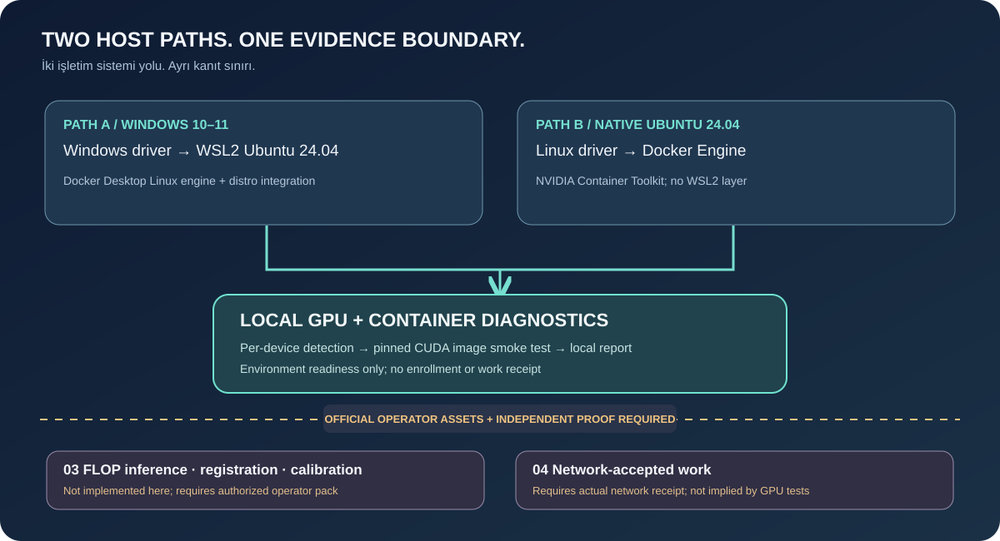

# 🇹🇷 FLOP GPU Miner — Gerçek kurulum rehberi (Windows / WSL2 / Ubuntu)

[English](VERIFIED-DEVNET-SETUP.en.md) · [Ana sayfa](../README.md) · [Sorun giderme](TROUBLESHOOTING.md)

> **Saha kaydı, 6 Kasım 2026:** Windows + WSL2 üzerinde **NVIDIA RTX 5090 Laptop GPU (24.463 MiB)** ile FLOP Devnet'te kayıt, sponsor stake, BF16 model doğrulaması, vLLM backend, HTTPS worker ve **130 GFLOP/s SOFT kalibrasyon** başarıyla doğrulandı. Bu sonuç **tüm GPU modelleri için garanti değil** ve **ücretli mining/ödül kanıtı değil**. Kanıtlar kullanıcı tarafından sağlanan gerçek terminal ve zincir çıktılarıdır. Bu repository'nin mevcut scriptleri *tanılama araçlarıdır*; resmî FLOP runtime paketini içermez.



## 0 — Hazırlık

Windows + WSL2 Ubuntu veya doğrudan Ubuntu, NVIDIA sürücüsü, Docker Linux engine, GPU container erişimi, yeterli disk ve aktif internet gerekir. Laptop ekran kartları masaüstü eşdeğerleriyle aynı performansı garanti etmez. WSL içinde ayrı Linux NVIDIA ekran sürücüsü kurma.

```bash
nvidia-smi --query-gpu=name,memory.total,driver_version --format=csv,noheader
docker info --format '{{.OSType}}'
docker compose version
```

**Güvenlik:** `signer`, 24 kelimelik mnemonic, `miner.json`, `miner.env` (gizli tokenlar), `session-keys` ve worker volume dosyalarını asla GitHub'a veya destek sohbetine yükleme. Her fiziksel host için ayrı miner hesabı/keystore kullan. Resmî imaj sürüm ve digest bilgilerini [releases manifest](https://flop.network/releases.json) ile doğrula.

## 1 — Resmî CLI ve mevcut kurulum

Bu bölüm **/opt/flop-miner altında operatör paketini zaten kurmuş** makineler içindir. Yalnızca bu repo ile sıfırdan tam kurulum yapılmaz; resmî [miner kılavuzunu](https://docs.flop.network/docs/run-miner) ve [UfukNode örneğini](https://github.com/UfukNode/flop-miner-setup/blob/main/Turkce-Kurulum.md) önce incele. Rastgele scriptleri ve `curl | bash` komutlarını çalıştırma.

```bash
cd /opt/flop-miner
FLOP_CLI=$(sed -n 's/^FLOP_CLI=//p' miner.env)
test -n "$FLOP_CLI" || { echo 'FLOP_CLI eksik'; exit 1; }
docker run --rm --network host "$FLOP_CLI" --network devnet --rpc wss://rpc.devnet.flop.network network status
```

CLI sürümü 0.1.220 ile doğrulanan örnekte worker 0.1.238, backend 0.1.239 idi. İmaj digestlerini sabitle.

## 2 — Miner cüzdanı ve sponsor

**Validator kurmuyorsun.** Miner için ayrı sr25519 signer gerekir. Mevcut bir signer varsa **üzerine yazma**. Sponsor, uygun bulduğu hesap için miner kaydını ve kilitli test stake'i sağlar. Sponsorlu kayıtta ayrıca `miner register` çalıştırma.

Sponsor isteminin önceki çıktıları `HTTP 429 auto_miner_cap_full` (kalibrasyon bekleyen miner sınırı) ve `daily_new_sponsorships` (kayan 24 saat limiti) idi. `retryAfterSeconds` sunucu önerisidir; kontenjanın tam o zamanda açılacağının garantisi değildir. Yeni cüzdanlarla limit aşmaya çalışma.

```bash
MINER_ADDRESS='YOUR_OWN_SS58_MINER_ADDRESS'
docker run --rm --network host "$FLOP_CLI" --network devnet --rpc wss://rpc.devnet.flop.network miner status "$MINER_ADDRESS" --json
```

Beklenen: `registered:true`, `stake.active:true`. Örnek saha hesabı `5H46MswbTSXsej7cQgBmmwHfNNrLDs2c8no4MezvK4NaDezd` için `delegated:1000000` gösterdi. Bu adres **örnek**; başkasının adresini kendi yapılandırmana yazma.

## 3 — Zincirde kayıtlı BF16 modeli doğrulayarak indir

Sahada başarıyla doğrulanan model `Qwen/Qwen2.5-0.5B-Instruct`; BF16 kökü `0x1a52c1abe781db051e70ae357f72bb70161ca0c092df0b618f22a9292ba63306`. İlk denemelerde `MODEL_VERIFICATION_FAILED` ve `terminated` görüldü. Nihai `model fetch` sonucu `ok:true`, `computed_root` eşleşti; 10 dosya ve yaklaşık 943 MB `model.safetensors` indirildi.

```bash
docker run --rm --network host -v /opt/flop-miner:/work "$FLOP_CLI" \
  --network devnet --rpc wss://rpc.devnet.flop.network \
  model fetch 0x1a52c1abe781db051e70ae357f72bb70161ca0c092df0b618f22a9292ba63306 \
  --precision BF16 --output-dir /work/models/qwen2.5-0.5b-instruct --json
```

**İpuçları:** Aynı anda üç `model fetch` başlatma. İndirme klasörü boşsa `docker ps`, `docker top`, `docker logs` ile tanı koy. Sadece küçük `config.json` için HTTP 200 almak büyük ağırlıkların indirileceği anlamına gelmez. `FP16` denemesinde `no measured root` hatası görüldü; bu model için saha başarısı **BF16** ile elde edildi. `model show` bu CLI'de yok, sorgulama için `model get` var. Kayıtlı hash doğrulamasını atlama.

## 4 — GPU backend

```bash
docker compose --env-file miner.env -f docker-compose.yml up -d backend
docker compose --env-file miner.env -f docker-compose.yml logs --tail=100 backend
docker compose --env-file miner.env -f docker-compose.yml exec -T backend python3 -c '
import os,json,urllib.request as u
req=u.Request("http://127.0.0.1:8000/health",headers={"Authorization":"Bearer "+os.environ["INFERENCE_API_KEY"]})
d=json.loads(u.urlopen(req,timeout=20).read())
print(json.dumps({k:d.get(k) for k in ("model_identity","model_hash","precision","decode_policy_hash","image")},indent=2))
'
```

Sahada `model_identity: measured`, `precision: bf16`, model hash ve decode policy eşleşti. Backend 8000 portunu **internete açma**.

## 5 — Cloudflare HTTPS tüneli ve worker

Worker'ın oturum adresi **127.0.0.1:8645**, backend adresi değil. Ubuntu/WSL `systemd` servisinin çalıştığını doğrula. Cloudflare Quick Tunnel **geçici** ve yeniden başlatılınca hostname değişebilir.

```bash
ps -p 1 -o comm=
systemctl status flop-tunnel --no-pager
journalctl -u flop-tunnel --no-pager -n 100 | grep -oE 'https://[a-z0-9-]+\.trycloudflare\.com' | tail -1
```

Güncel host adını `miner.env` içinde `SESSION_PUBLIC_HOST` olarak **https:// olmadan** belirtip worker'ı başlat. `signer` kayıtlı miner hesabıyla eşleşmeli.

```bash
docker compose --env-file miner.env -f docker-compose.yml up -d worker
docker compose --env-file miner.env -f docker-compose.yml logs --tail=100 worker
```

Logda `Signer:`, `model-gate OK`, `[ghost] published ghost key`, `Session host listening on :8645`, `Endpoint ad ... published` görülmeli. Dışarıdan `/session/info` HTTP 401 dönmesi, adresin erişilip kimlik doğrulaması istediğini gösterir; kalibrasyon tamamlandığını göstermez.

## 6 — Kalibrasyon, gerçek işler ve stake

```bash
docker compose --env-file miner.env -f docker-compose.yml logs worker | grep -c '\[ghost\] answered task'
docker run --rm --network host "$FLOP_CLI" --network devnet --rpc wss://rpc.devnet.flop.network miner status "$MINER_ADDRESS" --json
```

**Saha sonucu:** 72 Ghost yanıtı loglandı; zincir `verifiedJobs:64`, `burstElapsedBlocks:623`, `capGflopsPerSec:130`, `assuranceTier:Soft`, `acceptedAt:3021110` döndürdü. `answered task` ile `verifiedJobs` aynı metrik değildir.

1.000.000 test FLOP sponsor stake'i aktifti; **başarılı kalibrasyon** varsa ikinci sponsor işlemi gerekmeyebilir. Daha yüksek teminat ihtiyacını zincir kayıtlarına göre değerlendir. **Devnet kalibrasyonu ücretli mining veya airdrop kanıtı değildir.**

## 7 — GPU envanterini zincire yazma (isteğe bağlı)

Bu **ücretli zincir işlemi** küçük test token ücreti harcayabilir. Önce şifreli keystore adresini **özel anahtar açığa çıkarmadan** doğrula:

```bash
docker run --rm --network none -v /opt/flop-miner:/work:ro "$FLOP_CLI" keys inspect /work/miner.json
```

Adres doğruysa keystore parolasını **terminalde gizli** gir, şifreyi chat'e yazma:

```bash
read -r -s -p 'Keystore şifresi: ' FLOP_KEY_PASSWORD; export FLOP_KEY_PASSWORD; echo
nvidia-smi --query-gpu=name,memory.total --format=csv,noheader,nounits | \
 docker run -i --rm --network host -e FLOP_KEY_PASSWORD -v /opt/flop-miner:/work "$FLOP_CLI" \
 --network devnet --rpc wss://rpc.devnet.flop.network \
 --keystore /work/miner.json --password-env FLOP_KEY_PASSWORD \
 miner declare-gpu --nvidia-smi -
unset FLOP_KEY_PASSWORD
```

Saha işleminde [GPU envanter bildirimi](https://explorer.devnet.flop.network/transactions/0x970f88289f3beaac756f8ec416cf9f120bebaebbc143c66f24f497eaecf0b753) `flop.gpu-inventory.v1` kaydetti. Buna rağmen `attested_gpu_inventory:[]` kalabildi; **donanım beyanı ile donanım attestation farklıdır**. Gereksiz ikinci beyan gönderme.

## 8 — 7/24 güvenli işletim

Windows uyku modunu engelle; WSL'nin Windows açılışında kendiliğinden başlamasını ayrıca yapılandır. Worker ve backend'i `docker compose ps` ile kontrol et. Tünel URL'si değiştiğinde env/worker duyurusunu güncelle. Signer, keystore ve kalıcı volume'leri yedekle. **`docker compose down -v` çalıştırma.** Laptop ısısını ve güç limitini `nvidia-smi` ile takip et.

[Resmî doküman](https://docs.flop.network/docs/run-miner) · [UfukNode Türkçe rehber](https://github.com/UfukNode/flop-miner-setup/blob/main/Turkce-Kurulum.md). Kullanıcı gözlemleri sahadan aktarılmıştır; repo, üçüncü taraf çalışma kodlarını kopyalamaz.
